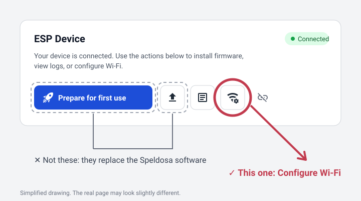

# Speldosa setup guide

Speldosa is a music box for children. Put a tag on the box and the music, story or audiobook linked to it plays
on a speaker in the room. Lift the tag and it pauses. Put it back and it continues. A tag is anything with an NFC
chip in it: a card, a coin or a sticker.

On svenska: [setup-guide.sv.md](setup-guide.sv.md).

## Requirements

| | |
|---|---|
| Home Assistant | 2026.10 or later, with HACS installed |
| Music Assistant | Set up in Home Assistant, with your music service (for example Spotify) and your speakers in it |
| A computer | With Chrome or Edge, for the Wi-Fi step. iPhone and iPad do not work for this step |
| A USB-C cable | One that carries data. Many cables only charge |
| Wi-Fi | A 2.4 GHz network. Speldosa does not use 5 GHz |

The box arrives with its software already on it. Setting it up takes about 15 minutes.

## 1. Connect the box to Wi-Fi

The box learns your Wi-Fi password over the USB cable, from a web page. The page has one small Wi-Fi button that
is easy to miss, and a large blue button you must **not** press. Read this step through once before you start.

1. Plug the box into the computer with the USB-C cable.
2. Open <https://web.esphome.io> in Chrome or Edge on the computer and select **Connect**.
3. Chrome opens a small window, "web.esphome.io wants to connect to a serial port". Pick the line that says
   **USB JTAG/serial debug unit** (with COM3, ttyACM0 or similar after it) and select **Connect**.
   If the list is empty, see Troubleshooting below: it is almost always the cable.
4. The page now shows a card, **ESP Device**, marked **Connected**. Under the text are one large blue button and
   four small buttons:

   

   | Button | What it does | For Speldosa |
   |---|---|---|
   | **Prepare for first use** (large, blue, rocket) | Replaces the software on the box with plain ESPHome | **Do not press.** The box stops being a Speldosa |
   | Arrow up (small, 1st) | Install other software | Do not press |
   | Page with lines (small, 2nd) | Shows the box's log | Not needed |
   | **Wi-Fi fan with a small cog (small, 3rd)** | **Configure Wi-Fi** | **Press this one** |
   | Broken chain link (no frame) | Disconnect | Not needed |

   The small buttons have no text. Hold the mouse over one and its name appears; the right one says
   **Configure Wi-Fi**.
5. A window opens. It says "Connecting", then "Searching for networks" for a few seconds. Then it shows
   **Configure Wi-Fi** with Device Info at the top (the name starts with `speldosa-`).
6. Under **Network**, pick your Wi-Fi. Pick a 2.4 GHz network: if your router shows two names, the one with 5G or
   5GHz in it does not work. A hidden network is under **Join other…**.
7. Type the Wi-Fi password under **Password** and select **Connect**. It says "Provisioning" for up to half a
   minute.
8. **Provisioned!** with a 🎉 means the box is on your Wi-Fi. Select **Close**. If it says **Unable to connect**,
   the password was wrong or the network is 5 GHz: correct it and select **Connect** again.
9. Unplug the box and plug it into its USB power supply in the child's room. It remembers the Wi-Fi.

The light pulses orange while the box has no Wi-Fi and pulses blue while it waits for Home Assistant (step 2).

## 2. Add the box to Home Assistant

1. Home Assistant shows **New devices discovered: Speldosa** under Settings, Devices and services. Select **Add**.
2. If nothing shows after a minute: Settings, Devices and services, **Add integration**, ESPHome, and enter the
   box's address from your router.
3. When the box is added, its light turns steady green.

## 3. Install the Speldosa integration

1. In Home Assistant open **HACS**, the menu at the top right, **Custom repositories**.
2. Add `https://github.com/andreas0480/speldosa-home-assistant` with the type **Integration**.
3. Search HACS for **Speldosa**, select **Download**, and restart Home Assistant when it asks.
4. Settings, Devices and services, **Add integration**, **Speldosa**. Pick the box and the speaker it should
   play on.

A **Speldosa** page appears in the sidebar.

## 4. Link the tags

1. Put a new tag on the box and leave it there. The light blinks pink and the box gives two short sounds:
   the tag has no music yet.
2. Open **Speldosa** in the sidebar. A blue banner says a new tag is on the box. Select **Link this tag**.
3. Type what the tag should play, for example "Bamse" or "Die drei ???". The results come from your music
   service. If nothing comes back, Spotify may be busy: wait half a minute and try again.
4. Pick a result. On the right, choose how it plays (below) and select **Link tag**. It starts playing.

Repeat for each tag.

## Play choices

| Choice | Best for | What happens |
|---|---|---|
| A random album each time | Audiobook series where each album is one episode (Die drei ???, Bamse, Bibi Blocksberg) | Plays one whole album, in order. Every album you chose is heard once before any repeats |
| The next album each time | Series heard in order | Plays the albums one after another, in episode-number order |
| From the start | Albums, playlists, songs | Starts at the beginning each time |
| In random order | Playlists, albums, an artist's music | Shuffles |
| Continue where it stopped | Audiobooks | Always continues where it was. Heard to the end, it starts over |
| A random or the next episode | Podcasts | Like the album choices, one episode at a time |

For the two album choices the page lists the artist's albums. Advent calendars, soundtracks, minis and similar are
unticked, and when most albums carry an episode number, only numbered ones are ticked. Tick or untick as you like.

Lifted halfway through, an album continues from that spot when the tag comes back, however much later. The tag
moves on to a new album only when the album has been heard to the end.

## Lifting and putting back

- Lift the tag: the music pauses.
- Put it back within 15 minutes: it continues where it was, whatever the tag's choice.
- After that the tag's choice decides, as in the table above.

The 15 minutes, the start volume (40 %), whether the box leaves a speaker group first and the music account
(below) are set per box under Settings, Devices and services, Speldosa, **Configure**.

## Two boxes playing at the same time

A Spotify account plays one thing at a time, so with one account the second box stops the first. With a Spotify
Premium Family plan, each family member has an account of their own at no extra cost. Give each box its own:

1. In Music Assistant: Settings, Music sources, **Add a music source**, Spotify, and sign in with the second
   family member's account. Music Assistant now has two Spotify accounts.
2. In Home Assistant: Settings, Devices and services, Speldosa, **Configure** on one box. **Music account**
   appears once Music Assistant has two accounts of the same service. Pick the account for this box.
3. Do the same on the other box with the other account.

The tags stay shared: any tag plays on any box, through that box's account. Leave **Music account** at its
first choice to play each tag through the account it was linked with.

## Light and sound

| Light | Meaning |
|---|---|
| Steady green | Ready, no tag on it |
| Steady yellow | A tag is on it and playing |
| Yellow, half bright | Paused |
| Short white flash | A tag was read |
| Pink blink, two sounds | The tag has no music yet: link it on the Speldosa page |
| Orange pulse | No Wi-Fi |
| Blue pulse | No connection to Home Assistant |
| Red blink | Something went wrong: Home Assistant shows a notification with the reason |

## Troubleshooting

| What you see | What to do |
|---|---|
| web.esphome.io does not list the box | Try another USB-C cable; many only charge. Use Chrome or Edge on a computer |
| No Wi-Fi window after the Wi-Fi button, or "Could not open the serial port" | Unplug the box, plug it back in, reload web.esphome.io and start again from **Connect** |
| **Prepare for first use** or Install was pressed by mistake | The box no longer has the Speldosa software. Tell us: it has to be reinstalled |
| Orange pulse after the Wi-Fi step | The network is 5 GHz only, or the password was wrong. Repeat step 1 |
| Blue pulse | Home Assistant has not added the box yet (step 2) |
| Red blink and "could not play" | The notification says why. Common causes: the speaker is off, or the music service is playing on another speaker. Spotify plays on one speaker at a time |
| Red blink and "Reader problem" on the page | Unplug the box for a few seconds and plug it back in |
| Search is slow or finds nothing | Spotify is limiting Music Assistant's searches ("rate limit"; Music Assistant's log says "Spotify Rate Limiter" or "asked to wait ... seconds"). Wait a minute and search again. For good: create your own free Spotify developer app and enter its Client ID in Music Assistant, Settings, Providers, Spotify; with the shared default ID the limit is reached quickly. This fixed it on our own setup (2026-11-26) |
| The tag plays the wrong thing | Speldosa page, the tag, **Change** |
| One box stops when the other starts | Both play through the same Spotify account. Give each box its own (Two boxes playing at the same time) |

## Updates

New versions of the integration show up in HACS. New firmware for the box shows up as an update under the box's
device page in Home Assistant.
