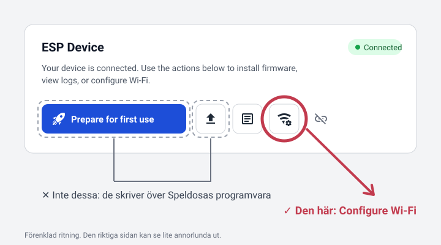

# Speldosa, så kommer du igång

Speldosa är en speldosa för barn. Lägg en bricka på speldosan så spelas musiken, sagan eller ljudboken som hör
till brickan i en högtalare i rummet. Lyft brickan så pausar det. Lägg tillbaka den så fortsätter det. En bricka är
allt med ett NFC-chip i: ett kort, ett mynt eller ett klistermärke.

In English: [setup-guide.md](setup-guide.md).

## Krav

| | |
|---|---|
| Home Assistant | 2026.10 eller senare, med HACS installerat |
| Music Assistant | Uppsatt i Home Assistant, med din musiktjänst (till exempel Spotify) och dina högtalare |
| En dator | Med Chrome eller Edge, för Wi-Fi-steget. iPhone och iPad fungerar inte för det steget |
| En USB-C-kabel | En som klarar data. Många kablar laddar bara |
| Wi-Fi | Ett 2,4 GHz-nätverk. Speldosan använder inte 5 GHz |

Speldosan kommer med programvaran redan installerad. Det tar ungefär en kvart att komma igång.

## 1. Anslut speldosan till Wi-Fi

Speldosan får ditt Wi-Fi-lösenord via USB-kabeln, från en webbsida. Sidan har en liten Wi-Fi-knapp som är lätt att
missa, och en stor blå knapp som du **inte** ska trycka på. Läs igenom steget en gång innan du börjar.

1. Koppla speldosan till datorn med USB-C-kabeln.
2. Öppna <https://web.esphome.io> i Chrome eller Edge på datorn och välj **Connect**.
3. Chrome öppnar ett litet fönster, "web.esphome.io wants to connect to a serial port" (på svenska "vill ansluta
   till en serieport"). Välj raden **USB JTAG/serial debug unit** (med COM3, ttyACM0 eller liknande efter) och
   välj **Connect** (Anslut). Är listan tom, se Felsökning nedan: det är nästan alltid kabeln.
4. Sidan visar nu ett kort, **ESP Device**, märkt **Connected**. Under texten finns en stor blå knapp och fyra små
   knappar:

   

   | Knapp | Vad den gör | För Speldosa |
   |---|---|---|
   | **Prepare for first use** (stor, blå, raket) | Byter programvaran på speldosan mot vanlig ESPHome | **Tryck inte.** Då slutar den vara en speldosa |
   | Pil uppåt (liten, 1:a) | Installerar annan programvara | Tryck inte |
   | Papper med rader (liten, 2:a) | Visar speldosans logg | Behövs inte |
   | **Wi-Fi-solfjäder med ett litet kugghjul (liten, 3:e)** | **Configure Wi-Fi** | **Tryck på den här** |
   | Bruten kedjelänk (utan ram) | Kopplar från | Behövs inte |

   De små knapparna har ingen text. Håll musen över en så visas namnet; den rätta heter **Configure Wi-Fi**.
5. Ett fönster öppnas. Det står "Connecting" och sedan "Searching for networks" några sekunder. Sedan visas
   **Configure Wi-Fi** med Device Info överst (namnet börjar med `speldosa-`).
6. Under **Network** väljer du ditt Wi-Fi. Välj ett 2,4 GHz-nät: visar routern två namn fungerar inte det med 5G
   eller 5GHz i namnet. Ett dolt nätverk finns under **Join other…**.
7. Skriv Wi-Fi-lösenordet under **Password** och välj **Connect**. Det står "Provisioning" i upp till en halv
   minut.
8. **Provisioned!** med en 🎉 betyder att speldosan är på ditt Wi-Fi. Välj **Close**. Står det **Unable to
   connect** var lösenordet fel eller nätet är 5 GHz: rätta det och välj **Connect** igen.
9. Koppla ur speldosan och sätt den i sin USB-laddare i barnets rum. Den minns Wi-Fi-nätet.

Lampan pulserar orange så länge speldosan saknar Wi-Fi och pulserar blått medan den väntar på Home Assistant
(steg 2).

## 2. Lägg till speldosan i Home Assistant

1. Home Assistant visar **Nya enheter hittades: Speldosa** under Inställningar, Enheter och tjänster. Välj
   **Lägg till**.
2. Syns inget efter en minut: Inställningar, Enheter och tjänster, **Lägg till integration**, ESPHome, och skriv
   speldosans adress från routern.
3. När speldosan är tillagd lyser lampan grönt.

## 3. Installera Speldosa-integrationen

1. Öppna **HACS** i Home Assistant, menyn uppe till höger, **Anpassade arkiv** (Custom repositories).
2. Lägg till `https://github.com/andreas0480/speldosa-home-assistant` med typen **Integration**.
3. Sök efter **Speldosa** i HACS, välj **Ladda ner** och starta om Home Assistant när det frågar.
4. Inställningar, Enheter och tjänster, **Lägg till integration**, **Speldosa**. Välj speldosan och högtalaren
   den ska spela på.

En sida som heter **Speldosa** dyker upp i sidofältet.

## 4. Koppla brickorna

1. Lägg en ny bricka på speldosan och låt den ligga kvar. Lampan blinkar rosa och speldosan ger två korta ljud:
   brickan har ingen musik ännu.
2. Öppna **Speldosa** i sidofältet. En blå ruta säger att en ny bricka ligger på speldosan. Välj **Koppla
   brickan**.
3. Skriv vad brickan ska spela, till exempel "Bamse" eller "Die drei ???". Träffarna kommer från din musiktjänst.
   Kommer inget tillbaka kan Spotify vara upptaget: vänta en halv minut och försök igen.
4. Välj en träff. Till höger väljer du hur brickan ska spela (se nedan) och sedan **Koppla brickan**. Det börjar
   spela.

Gör likadant för varje bricka.

## Spelval

| Val | Passar för | Det här händer |
|---|---|---|
| Ett slumpvis album varje gång | Ljudboksserier där varje album är ett avsnitt (Die drei ???, Bamse, Bibi Blocksberg) | Spelar ett helt album i ordning. Varje valt album hörs en gång innan något upprepas |
| Nästa album varje gång | Serier som lyssnas på i ordning | Spelar albumen efter varandra, i avsnittsordning |
| Från början | Album, spellistor, låtar | Börjar från början varje gång |
| I slumpvis ordning | Spellistor, album, en artists musik | Blandar |
| Fortsätt där det slutade | Ljudböcker | Fortsätter alltid där det var. Hörd till slutet börjar den om |
| Ett slumpvis eller nästa avsnitt | Poddar | Som albumvalen, ett avsnitt i taget |

För de två albumvalen visar sidan artistens album. Adventskalendrar, soundtrack, minis och liknande är inte
ikryssade, och när de flesta album har ett avsnittsnummer är bara de numrerade ikryssade. Kryssa i eller ur som
du vill.

Lyfts brickan mitt i ett album fortsätter det där när brickan kommer tillbaka, hur länge det än dröjer. Brickan går
vidare till ett nytt album först när albumet har hörts till slutet.

## Lyfta och lägga tillbaka

- Lyft brickan: musiken pausar.
- Lägg tillbaka den inom 15 minuter: det fortsätter där det var, oavsett hur brickan är inställd.
- Efter det bestämmer brickans val, som i tabellen ovan.

De 15 minuterna, startvolymen (40 %), om speldosan först ska lämna en högtalargrupp och musikkontot (nedan)
ställs in per speldosa under Inställningar, Enheter och tjänster, Speldosa, **Konfigurera**.

## Två speldosor som spelar samtidigt

Ett Spotify-konto spelar en sak i taget, så med ett konto stoppar den andra speldosan den första. Med Spotify
Premium Family har varje familjemedlem ett eget konto utan extra kostnad. Ge varje speldosa sitt eget:

1. I Music Assistant: Inställningar, Music sources, **Add a music source**, Spotify, och logga in med den andra
   familjemedlemmens konto. Music Assistant har nu två Spotify-konton.
2. I Home Assistant: Inställningar, Enheter och tjänster, Speldosa, **Konfigurera** på den ena speldosan.
   **Musikkonto** visas när Music Assistant har två konton för samma tjänst. Välj kontot för den här speldosan.
3. Gör likadant på den andra speldosan med det andra kontot.

Brickorna är gemensamma: alla brickor spelar på alla speldosor, via speldosans konto. Låt **Musikkonto** stå på
det första valet för att spela varje bricka via kontot den kopplades med.

## Ljus och ljud

| Lampan | Betyder |
|---|---|
| Lyser grönt | Redo, ingen bricka på |
| Lyser gult | En bricka ligger på och spelar |
| Gult, halvt ljus | Pausad |
| Kort vit blink | En bricka lästes |
| Blinkar rosa, två ljud | Brickan har ingen musik ännu: koppla den på sidan Speldosa |
| Pulserar orange | Inget Wi-Fi |
| Pulserar blått | Ingen kontakt med Home Assistant |
| Blinkar rött | Något gick fel: Home Assistant visar ett meddelande med orsaken |

## Felsökning

| Det här ser du | Gör så här |
|---|---|
| Inget Wi-Fi-fönster efter Wi-Fi-knappen, eller "Could not open the serial port" | Koppla ur speldosan, sätt i den igen, ladda om web.esphome.io och börja om från **Connect** |
| **Prepare for first use** eller Install trycktes av misstag | Speldosan har inte längre Speldosas programvara. Säg till oss: den måste installeras om |
| web.esphome.io hittar inte speldosan | Prova en annan USB-C-kabel; många laddar bara. Använd Chrome eller Edge på en dator |
| Pulserar orange efter Wi-Fi-steget | Nätverket är bara 5 GHz, eller lösenordet var fel. Gör om steg 1 |
| Pulserar blått | Home Assistant har inte lagt till speldosan ännu (steg 2) |
| Blinkar rött och "kunde inte spela" | Meddelandet säger varför. Vanliga orsaker: högtalaren är av, eller musiktjänsten spelar på en annan högtalare. Spotify spelar på en högtalare i taget |
| Blinkar rött och "Problem med läsaren" på sidan | Dra ur sladden några sekunder och sätt i den igen |
| Sökningen är långsam eller hittar inget | Spotify begränsar Music Assistants sökningar ("rate limit"; i Music Assistants logg står "Spotify Rate Limiter" eller "asked to wait ... seconds"). Vänta en minut och sök igen. Varaktigt: skapa en egen gratis Spotify developer-app och ange dess Client ID i Music Assistant, Inställningar, Providers, Spotify; med det delade standard-ID:t nås gränsen snabbt. Det löste det hos oss (2026-11-26) |
| Brickan spelar fel sak | Sidan Speldosa, brickan, **Ändra** |
| Den ena speldosan stannar när den andra startar | Båda spelar via samma Spotify-konto. Ge varje speldosa sitt eget (Två speldosor som spelar samtidigt) |

## Uppdateringar

Nya versioner av integrationen syns i HACS. Ny programvara till speldosan syns som en uppdatering på speldosans
enhetssida i Home Assistant.
